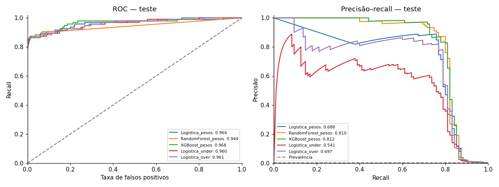
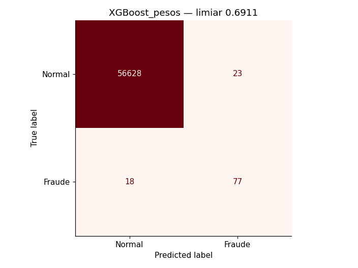
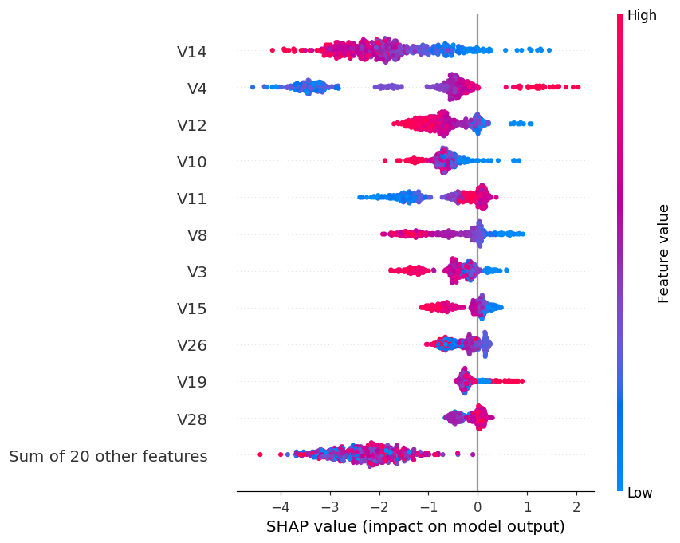
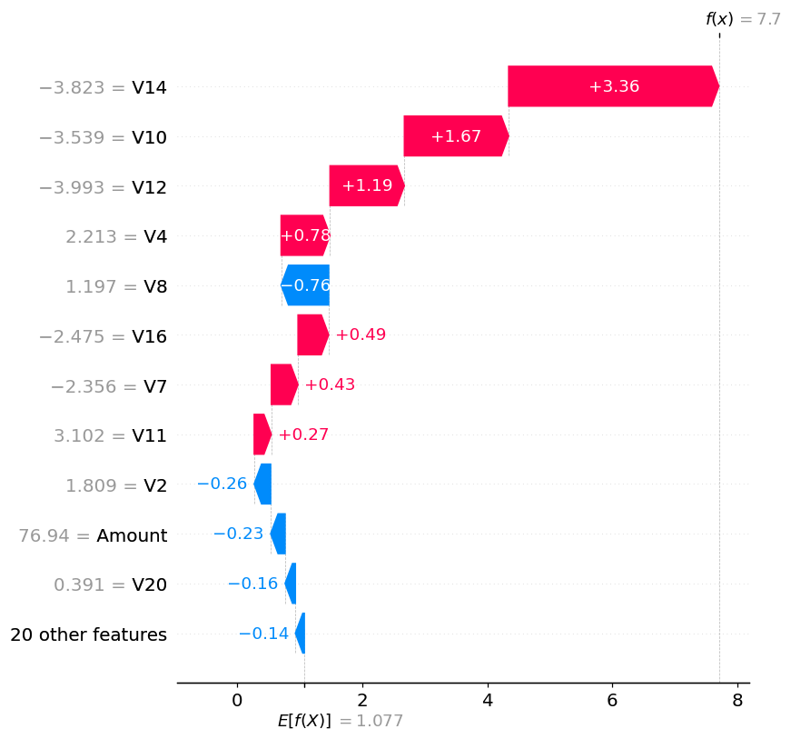

# Detecção de fraude em cartões de crédito

**Autor: Giordani Martins Silva · Projeto educacional DIO**

Pipeline completo em Python com dados reais: exploração, preparação, tratamento do desbalanceamento, comparação de modelos, ajuste de limiar e explicações SHAP.

**[Abrir o notebook com as saídas salvas](notebooks/deteccao_fraude.ipynb)**

## Problema: acurácia pode enganar

A base bruta tem **284,807 transações e 492 fraudes** (0,173%). Um classificador que sempre responda “normal” tem cerca de 99,83% de acurácia, mas encontra zero fraudes. Por isso, o projeto prioriza o recall da classe 1, acompanhado de precisão, F1, falsos positivos/negativos e average precision (AP). ROC-AUC é complementar.

- **Recall:** entre as fraudes reais, quantas foram detectadas.
- **Precisão:** entre os alertas emitidos, quantos eram fraudes reais.
- **F1:** média harmônica de precisão e recall.
- **AP:** resumo da curva precisão–recall; não é a área trapezoidal.

## Dados e origem

CSV carregado por [URL pública](https://storage.googleapis.com/download.tensorflow.org/data/creditcard.csv), documentada no [tutorial oficial do TensorFlow](https://www.tensorflow.org/tutorials/structured_data/imbalanced_data). A origem da base é a colaboração ULB/Worldline, com página no [Kaggle](https://www.kaggle.com/datasets/mlg-ulb/creditcardfraud).

O link da Aula 1 não foi fornecido. Utilizei esse espelho documentado da base correspondente ao esquema do desafio, sem alegar que seja a mesma URL do vídeo. O dataset **não está no repositório**. Não há dados sintéticos substituindo a base real.

Colunas: `Time`, `Amount`, `Class` e `V1`–`V28`. As variáveis V já passaram por PCA para preservar privacidade; não conhecemos seu significado original.

## Preparação e prevenção de vazamento

1. Validação de esquema, ausência de nulos, valores finitos e classes 0/1.
2. Remoção de **1,081 duplicatas exatas** antes da divisão: restaram **283,726 transações e 473 fraudes**. A deduplicação evita cópias idênticas em conjuntos diferentes; altera a distribuição observada, o que é explicitado.
3. Criação de `LogAmount = log1p(Amount)` e `ElapsedHours = Time / 3600`. Essa variável é tempo decorrido, não hora do dia. `Time` foi retirado após a conversão; `Amount` foi mantido.
4. Divisão estratificada com semente 42: 60% treino, 20% validação e 20% teste. Veja [contagens por conjunto](results/splits.csv).
5. `StandardScaler` ajustado apenas no treino, dentro dos pipelines logísticos. Árvores usam as features sem padronização.
6. Pesos de classe e reamostragem são calculados/aplicados apenas no treino. Validação e teste mantêm sua prevalência natural.

## Experimentos

- Regressão logística com `class_weight='balanced'`.
- Random Forest: 120 árvores, profundidade máxima 14 e `balanced_subsample`.
- XGBoost: 220 árvores, profundidade 4, learning rate 0,06 e `scale_pos_weight` calculado no treino.
- Regressão logística com RandomUnderSampler.
- Regressão logística com RandomOverSampler.
- Baseline ingênuo: sempre normal.

Under e over usam razão minoria/maioria de 0,1 e não acumulam pesos balanceados. Todos compartilham a mesma divisão dos dados. Hiperparâmetros foram definidos antes do teste; não executei GridSearchCV.

## Limiar: decisão tomada na validação

A regra escolhida previamente foi **maximizar recall sujeito a precisão ≥ 80% na validação**. O piso é uma hipótese didática para limitar falsos alarmes, não uma política real de banco. Desempates favorecem precisão. Se um modelo não alcança o piso, seu melhor F1 é mostrado apenas como alternativa não elegível.

O modelo selecionado na validação foi **XGBoost_pesos**, com limiar **0.691087**. O modelo não foi retreinado após essa seleção, preservando a correspondência entre seus escores e o limiar. A avaliação de teste não altera o vencedor.

[Resultados da validação](results/validation_metrics.csv) · [Resultados completos do teste, incluindo limiar 0,5](results/test_metrics.csv)

## Resultados reais no teste reservado

O teste contém 56.746 transações, incluindo 95 fraudes. Os números abaixo são da execução, com limiares congelados na validação:

| Modelo | Limiar | Recall fraude | Precisão fraude | F1 fraude | FP | FN | AP |
|---|---:|---:|---:|---:|---:|---:|---:|
| Logistica_pesos | 0.999995 | 76.84% | 83.91% | 0.8022 | 14 | 22 | 0.6885 |
| RandomForest_pesos | 0.341294 | 76.84% | 90.12% | 0.8295 | 8 | 22 | 0.8096 |
| XGBoost_pesos | 0.691087 | 81.05% | 77.00% | 0.7897 | 23 | 18 | 0.8119 |
| Logistica_under | 0.999498 | 52.63% | 67.57% | 0.5917 | 24 | 45 | 0.5408 |
| Logistica_over | 0.993640 | 71.58% | 81.93% | 0.7640 | 15 | 27 | 0.6973 |

O modelo escolhido encontrou **77 das 95 fraudes**, deixou passar **18** e gerou **23 falsos alarmes**. Precisão mínima em validação não garante a mesma precisão em teste. Os escores não foram calibrados e não devem ser tratados como probabilidades confiáveis de risco.





[Relatórios de classificação por modelo](results/classification_reports.txt) · [Gráfico de seleção do limiar](results/threshold_validation.png)

## O que o SHAP mostrou

A explicação SHAP é do **XGBoost**, independentemente do modelo vencedor. Foram utilizadas 500 transações aleatórias do teste para a visão global. As maiores médias de contribuição absoluta foram: **V14, V4, V12, V10, V11**. Como a amostra global contém majoritariamente operações normais, ela não representa uma análise exclusiva de fraudes.



O waterfall explica o primeiro alerta do XGBoost na ordem fixa do teste, índice **115676** na base deduplicada. A escolha foi feita pela previsão, antes de consultar o rótulo real. Seu escore foi **0.999547**, acima do limiar XGBoost **0.691087**; o rótulo real é **1** (1 = fraude).

- Maiores contribuições que aumentaram o escore: `V14` (+3.358), `V10` (+1.666), `V12` (+1.188).
- Maiores contribuições que reduziram o escore: `V8` (-0.760), `V2` (-0.263), `Amount` (-0.230).

Esses valores estão em **log-odds**, não em pontos percentuais. O notebook verifica numericamente que a soma da base com as contribuições, transformada pela função logística, reproduz o escore. SHAP explica o comportamento do modelo, não causalidade. Por causa do PCA, não atribuí significados como renda ou localização às variáveis V.



[Valores SHAP locais](results/shap_local.csv) · [Importância SHAP global](results/shap_global_importance.csv) · [Importância interna do XGBoost](results/feature_importance.png)

## Como reproduzir

Execução de referência: Python 3.12, CPU, semente 42. Dependências exatas em [requirements.txt](requirements.txt) e [versions.json](results/versions.json).

```bash
python -m venv .venv
# Windows:
.venv\Scripts\activate
# Linux/macOS: source .venv/bin/activate
python -m pip install -r requirements.txt
python -m ipykernel install --user --name python3
python executar.py
```

Também é possível abrir `notebooks/deteccao_fraude.ipynb` no Jupyter/VS Code e executar todas as células. A primeira execução baixa cerca de 151 MB; é necessário acesso à internet e memória suficiente para a base e os modelos. O tempo depende da máquina. O cache local é opcional: a variável de ambiente `CREDITCARD_PATH` pode apontar para uma cópia do mesmo CSV.

Neste ambiente, as células foram executadas sequencialmente em um único processo IPython, porque a comunicação por sockets do kernel Jupyter não estava disponível. As tabelas e imagens salvas são saídas reais dessa execução; não foram preenchidas manualmente. O script `executar.py` usa o fluxo padrão nbclient para um ambiente local com kernel disponível. A estrutura do notebook e a ausência de erros nas células foram verificadas.

## O que acrescentei ao roteiro do desafio

- Validação separada para escolher limiar e modelo antes de abrir o teste.
- Deduplicação documentada e checagens de integridade.
- Baseline ingênuo e comparação de pesos, undersampling e oversampling.
- Relatórios de falsos positivos/negativos e escores no limiar 0,5 e no limiar ajustado.
- Explicação global/local, com verificação da soma dos valores SHAP.
- Versões fixadas, resultados exportados e script de reexecução.

A comparação é com o roteiro do enunciado: não tive acesso ao notebook da Expert para verificar diferenças linha a linha. Projeto desenvolvido com assistência de IA; as decisões e os resultados estão documentados para estudo.

## Limitações e próximos passos

A divisão aleatória estratificada não simula implantação no futuro. A base cobre um período curto, não possui identificador de cliente e já contém PCA feito na origem, cujo ajuste não podemos auditar. Poucas fraudes tornam as métricas sensíveis à divisão. Não há garantia de generalização para outro banco.

Próximos passos: validação temporal, validação cruzada aninhada, calibração, definição de custos reais, capacidade da fila de análise e monitoramento de mudança de distribuição. Uma validação única e o piso didático de precisão não bastam para produção.

## Arquivos

- `notebooks/deteccao_fraude.ipynb`: notebook com saídas salvas.
- `results/`: métricas, gráficos, explicações e resumo da execução.
- `requirements.txt`: versões usadas.
- `executar.py`: reexecução completa.
- `.gitignore`: impede inclusão acidental do dataset.

## Referências técnicas

- [scikit-learn — escolha do limiar](https://scikit-learn.org/stable/modules/classification_threshold.html)
- [SHAP — TreeExplainer](https://shap.readthedocs.io/en/latest/generated/shap.TreeExplainer.html)
- [XGBoost — parâmetros](https://xgboost.readthedocs.io/en/stable/parameter.html)
